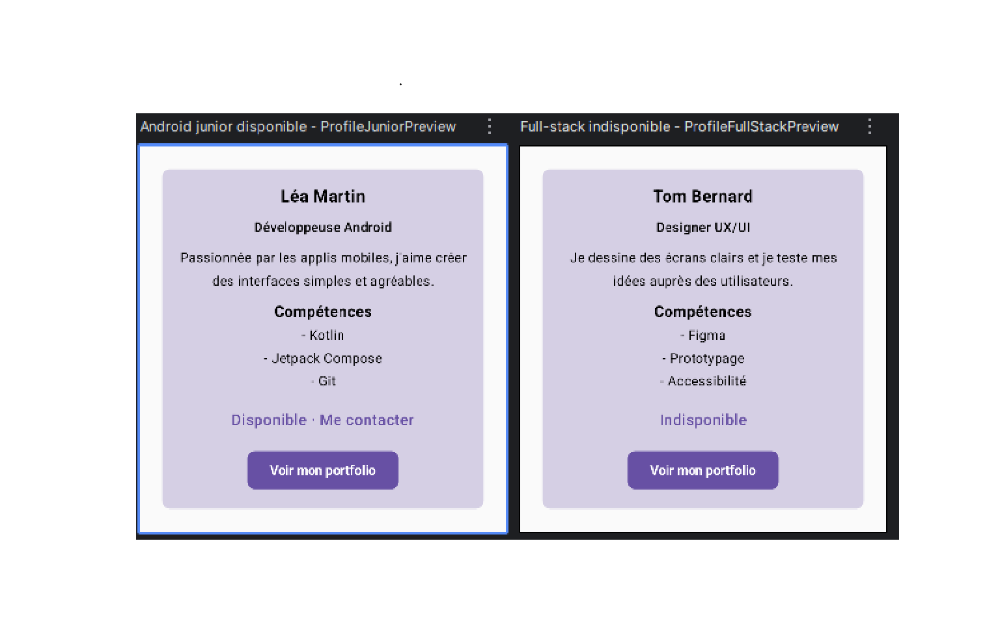

# Profil développeur Compose

## Description
J'ai fait un écran qui affiche la fiche d'un développeur avec Jetpack Compose.
Sur la fiche on voit le nom, le métier, une petite description, les compétences et si la personne est disponible ou pas.
On peut cliquer sur la zone « Disponible · Me contacter » pour contacter la personne, et sur le bouton « Voir mon portfolio ».
Pour l'instant les clics ne font rien, ils appellent juste une fonction vide.
Les infos du profil sont rangées dans une data class `Profile`, et j'ai créé deux faux profils pour tester.

## Notions utilisées
- les fonctions composables
- les paramètres
- une data class pour ranger les infos d'un profil
- le Modifier et le chaînage de modifiers
- le padding externe et le padding interne
- les callbacks (pour les clics)
- les previews
- l'accessibilité de base (`semantics`, `Role.Button`, `contentDescription`)

## Mes fichiers
- `Profile.kt` : la data class `Profile`, avec toutes les infos d'un profil.
- `ProfileData.kt` : `fakeProfiles`, mes deux faux profils (Léa, développeuse Android disponible, et Karim, développeur full-stack pas disponible).
- `ProfileScreen.kt` : tous mes composables et mes deux previews.

## Explication et réponse aux questions
1. **Quels composables avez-vous créés ?**
   ProfileScreen, ProfileCard, ProfileCardContent, ProfileFullName, ProfileJob, ProfileDescription, ProfileSkills, SkillItem, ProfileAvailability et ProfilePortfolioButton.

2. **Quel composable représente l'écran principal ?**
   C'est ProfileScreen. C'est lui qui choisit quel profil afficher et qui place la carte dans l'écran.

3. **Où utilisez-vous un padding externe ?**
   Dans ProfileScreen. Je mets `padding(24.dp)` sur la carte pour la décoller des bords de l'écran. C'est le parent qui décide où placer la carte.

4. **Où utilisez-vous un padding interne ?**
   Dans ProfileCardContent. Je mets `padding(16.dp)` sur la Column pour que le contenu ne touche pas les bords de la carte. C'est la carte qui gère l'espace à l'intérieur d'elle.

5. **Quel composant reçoit un callback ?**
   ProfilePortfolioButton reçoit `onPortfolioClick`, et ProfileAvailability reçoit `onAvailabilityClick`. Ils préviennent juste qu'il y a eu un clic. Ce n'est pas eux qui décident quoi faire, c'est ProfileScreen.

6. **Quelle information d'accessibilité avez-vous ajoutée ?**
   La zone « Disponible » est un simple `Text` que j'ai rendu cliquable avec `clickable`. Une personne aveugle qui utilise TalkBack ne pourrait pas savoir qu'on peut cliquer dessus. Alors j'ai ajouté `semantics` avec :
    - `role = Role.Button` : TalkBack dit que c'est un bouton ;
    - `contentDescription` : TalkBack lit une phrase qui explique ce que fait le clic (« Appuyer pour envoyer un message »).

   Ce texte ne s'affiche pas à l'écran, il est seulement lu à voix haute.
   Pour le bouton « Voir mon portfolio », je n'ai rien ajouté, parce qu'un `Button` dit déjà tout seul que c'est un bouton.

7. **Pourquoi vos composants peuvent-ils être considérés comme réutilisables ?**
   Parce qu'aucun composable n'a le texte du profil écrit en dur dedans : chacun reçoit ses infos en paramètres. Ils ont aussi tous un `modifier: Modifier = Modifier`, donc c'est le parent qui décide où les placer.
   La preuve, c'est mes deux previews : avec les mêmes composables, j'affiche deux profils différents (`fakeProfiles[0]` et `fakeProfiles[1]`).

## Capture

